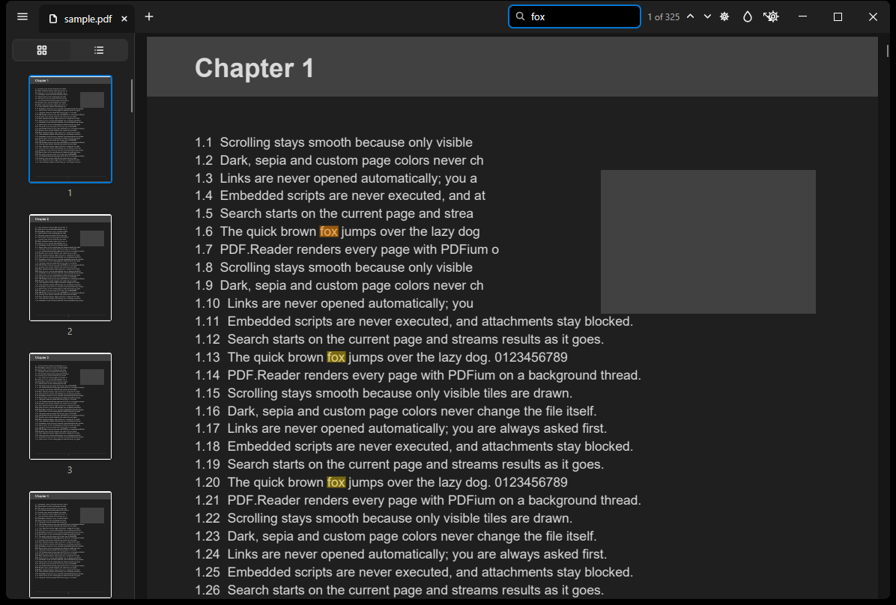

# PDF.Reader

[](https://github.com/jacksonhazara-creator/PDF.Reader/actions/workflows/ci.yml)
[](https://github.com/jacksonhazara-creator/PDF.Reader/releases)

A fast, simple and secure PDF reader for Windows. No ads, no account, no cloud, no telemetry.



## Why

- **Opens instantly.** Native AOT build, pages laid out before anything renders, low-res preview first, then sharp tiles for only what's on screen.
- **Secure by default.** Embedded JavaScript is never executed (the PDF engine has no JavaScript runtime at all). Links, attachments and "launch" actions never run automatically; a banner tells you when a document contains them.
- **Simple, powerful when needed.** The page fills the window. Everything else lives in **All tools** (☰) or the **command palette** (Ctrl+K).

## Features

| | |
|---|---|
| Reading | Continuous scroll, zoom (Ctrl+wheel, fit width/page), document tabs, reading mode (F11) |
| Find | Search with match-case / whole-word, results stream in as pages are scanned |
| Right panel | **Pages** (thumbnails + type a page number), **Bookmarks** (go to, add, delete), **Comments** (page, date, go to, delete). Collapses to a slim strip |
| Toolbar | Grouped tools with icon + name: **Select** (select, pan), **Comment** (add comment, replace selected text, insert text, text comment, attach file), **Marker** (highlight, underline, strikethrough), **Draw** (freehand, line, line arrow, arrow, rectangle, circle, text callout, polygon, cloud, connected line, stamps), **Text** (type text, cross, check, dot, circle around, cross out), **Signature** (signature, initials). Drag the grip to dock it left/right/top or let it float |
| Comments | Attached to the first or last word of the text; shapes: square, circle, cloud, speech bubble, star. Hover shows date, comment and the referenced text |
| Marker | Any color, adjustable transparency and color strength; on images it draws freehand |
| Saving | Save (Ctrl+S) appends changes as an incremental update, so the original bytes stay intact; Save as; asks before closing with unsaved changes; Undo (Ctrl+Z) |
| Page colors | Normal, Dark, Sepia, Custom. *Keep images natural* option. Display only, the file is never changed |
| Read aloud | Offline Windows voices (Ctrl+Shift+Y) |
| Print | Print button / Windows print dialog, original colors |
| Start screen | Open button, drag & drop, recent files with thumbnails |
| Session | Reopens your tabs at the page you left |
| Updates | Settings → Updates: check, changelog, download in background, restart to install. Stable or Beta channel |
| Languages | English, Deutsch |

All marks are standard PDF annotations (highlight, underline, strikeout, ink, square, circle, stamp, text, file attachment), so other PDF apps show them too. Signatures here are drawn/typed images, not certificate-based digital signatures (planned for Phase 4).
## Keyboard shortcuts

| Action | Keys |
|---|---|
| Open / close | Ctrl+O / Ctrl+W |
| Save / Save as | Ctrl+S / Ctrl+Shift+S |
| Undo last mark or comment | Ctrl+Z |
| Highlight / Comment / Draw / Type text | Ctrl+Shift+H / M / F / T |
| Command palette | Ctrl+K |
| All tools | Ctrl+T |
| Search, next, previous | Ctrl+F, F3, Shift+F3 |
| Zoom in / out | Ctrl+Plus / Ctrl+Minus, Ctrl+wheel |
| Fit width / actual size / fit page | Ctrl+0 / Ctrl+1 / Ctrl+2 |
| Go to page, first, last | Ctrl+G, Ctrl+Home, Ctrl+End |
| Right panel | F4 |
| Reading mode | F11 (Esc to leave) |
| Cycle page colors | Ctrl+Shift+D |
| Read aloud (start/stop) | Ctrl+Shift+Y |
| Print | Ctrl+P |
| Settings | Ctrl+, |

## Install

Download from [Releases](https://github.com/jacksonhazara-creator/PDF.Reader/releases):

- **`PDF.Reader-win-Setup.exe`**: per-user install, no admin rights, Start menu shortcut, automatic updates.
- **`PDF.Reader-win-Portable.zip`**: no install; unzip and run `PDF.Reader.exe`.

PDF.Reader adds itself to "Open with" for `.pdf` files but never makes itself the default app. Windows lets you choose that.

## Build

Requirements: Windows 10 1904x+ x64, [.NET 10 SDK](https://dotnet.microsoft.com/download).

```bash
dotnet build PdfReader.slnx
```

```bash
dotnet test PdfReader.slnx
```

```bash
dotnet run --project src/App
```

Native AOT publish (needs Visual Studio Build Tools with the "Desktop development with C++" workload):

```bash
dotnet publish src/App/PdfReader.App.csproj -c Release -r win-x64 -o publish
```

Generate a test document: `pwsh tools/make-sample-pdf.ps1 -Path sample.pdf -Pages 60`.

## Repository layout

```
src/App         Avalonia UI (views, view models, viewer control, services)
src/Core        Settings, session, search, command matching
src/Rendering   PDFium P/Invoke layer and single-threaded render engine
tests           xUnit tests incl. a mutation fuzzer for the open/parse path
tools           Sample PDF generator, perf budget check, release notes
docs            Architecture, roadmap, images
```

See [docs/ARCHITECTURE.md](docs/ARCHITECTURE.md) for the design decisions.

## Releasing

Push a tag: `v1.2.0` publishes a stable release; `v1.2.0-beta.1` publishes a pre-release for the Beta channel. GitHub Actions builds, tests, publishes with Native AOT, checks the startup budget, packs with Velopack, optionally signs, and creates the GitHub Release.

## License

[MIT](LICENSE). Third-party licenses: [THIRD-PARTY-NOTICES.md](THIRD-PARTY-NOTICES.md).
